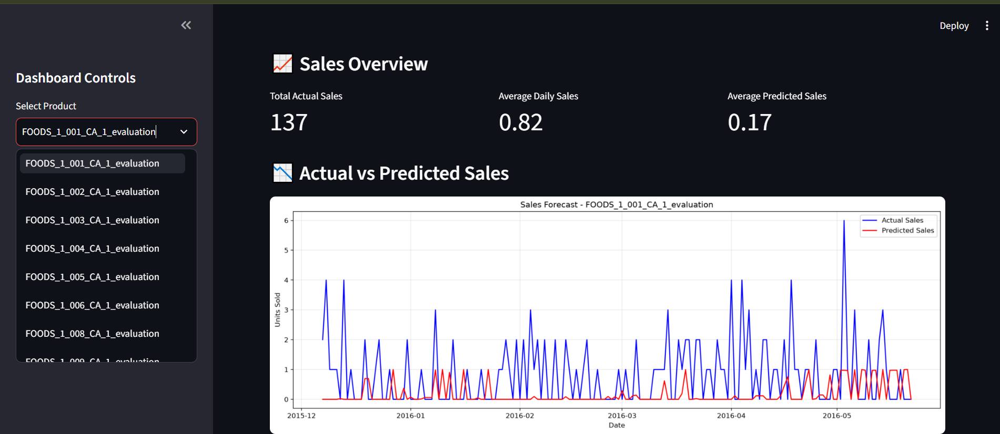
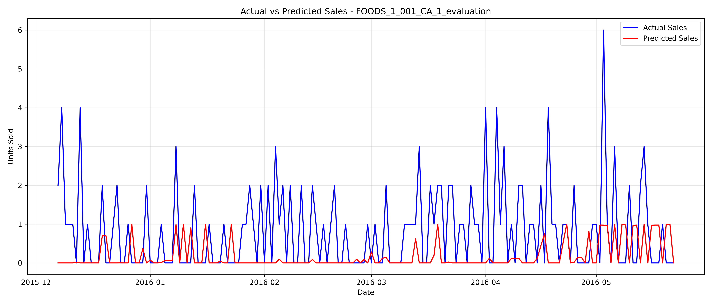

# 📊 Demand Forecasting & Inventory Optimization

## Project Overview

An end-to-end Data Science project using the Walmart M5 dataset
to forecast product demand and analyze forecasting performance.

The project demonstrates machine learning, time-series forecasting,
data analysis, and interactive dashboard development.

## Dataset

Walmart M5 Forecasting Dataset

The dataset contains:
- Historical daily product sales
- Product and store information
- Calendar events
- Product selling prices

Dataset Source:
https://www.kaggle.com/competitions/m5-forecasting-accuracy

## Technologies Used

- Python
- Pandas
- NumPy
- Scikit-learn
- Matplotlib
- Streamlit
- VS Code
- GitHub

## Project Workflow

1. Data Collection
2. Data Cleaning and Preprocessing
3. Exploratory Data Analysis
4. Feature Engineering
5. Machine Learning Model Training
6. Demand Forecasting
7. Model Evaluation
8. Interactive Dashboard Development

## Model Evaluation

The project evaluates forecasting performance by comparing
actual sales with predicted demand.

Evaluation Metric:
- Mean Absolute Error (MAE)

## Interactive Streamlit Dashboard

The dashboard provides:

- Product Selection
- Actual vs Predicted Sales Visualization
- Total Sales
- Average Daily Sales
- Average Predicted Sales
- Forecast Error Analysis
- Downloadable Prediction Data

## Dashboard Screenshot



## Actual vs Predicted Sales

The project visualizes actual product demand against
machine learning predictions.


## Run the Project

Install required libraries:

```bash
pip install pandas numpy scikit-learn matplotlib streamlit
```

Launch the dashboard:

```bash
python -m streamlit run dashboard.py
```

## Future Improvements

- Inventory Optimization
- Safety Stock Calculation
- Reorder Point Optimization
- Forecast Uncertainty Analysis
- Model Performance Monitoring

## Project Goal

Build a practical demand forecasting system that supports
data-driven inventory planning and business decisions.
